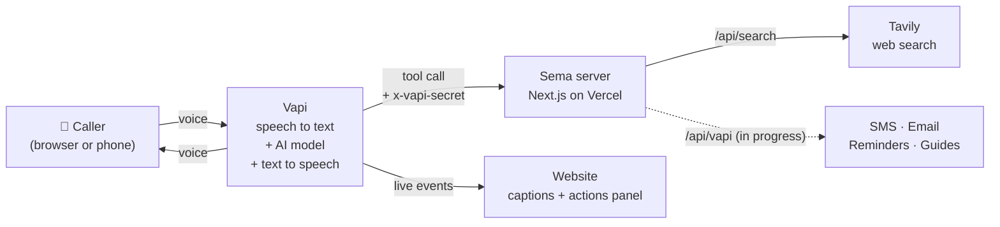

# Sema AI

**Your AI helper. One call away.**

Sema is a voice AI helper for people in rural Kenya. You talk to it in **Kiswahili, English or Sheng**, and it answers by voice in your language. No app, no typing and no reading are needed.

🔗 **Live demo:** https://sema-ai-beta.vercel.app — press the big button and speak.

**Hackathon tracks:** Accessibility (main) · Education · Health · Trust & Misinformation

---

## Why Sema?

Millions of Kenyans have a phone but find apps, menus and long text hard to use. Some cannot read well, some have poor eyesight, and some only have a basic phone. Yet they still need quick, trusted answers:

- *"Ng'ombe wangu ana homa, nifanye nini?"* (My cow has a fever, what should I do?)
- *"Is it true that hot lemon water cures malaria?"*
- *"Nikumbushe kumpa mtoto dawa baada ya saa moja."* (Remind me to give the child medicine in one hour.)

Sema lets them **just talk**. Voice is the most accessible interface there is.

## What Sema does

| | Feature | Status |
|---|---|---|
| 🎙️ | **Voice call in the browser.** Speak Kiswahili, English or Sheng, and Sema answers by voice. | ✅ Live |
| 💬 | **Live captions.** Large text (20px+) of what you and Sema say, for Deaf and hard-of-hearing users. | ✅ Live |
| 📋 | **Actions panel.** Shows every action Sema takes during the call, as it happens. | ✅ Live |
| 🌐 | **Web search** (`search_web`). Current facts with a Kenya focus, answered in about 1 second. | ✅ Live |
| 🇰🇪 | **Kiswahili / English toggle** for every label on the site. | ✅ Live |
| ✅ | **Rumour check** (`check_claim`). Gives a verdict (TRUE, FALSE, UNPROVEN or SCAM), a reason, a confidence score and sources. | 🚧 In progress |
| 📱 | **SMS steps** (`send_sms`). Sends the key steps by text after the call. | 🚧 In progress |
| 🖼️ | **Picture guides** (`create_guide`). A simple page of steps with icons and a "Sikiliza" (Listen) button. | 🚧 In progress |
| ⏰ | **Reminders** (`set_reminder`). An SMS reminder after a number of minutes you choose. | 🚧 In progress |
| ✉️ | **Email** (`send_email`). Only when the caller asks, after Sema confirms the address. | 🚧 In progress |
| ☎️ | **Phone number.** Call Sema from any phone, even a basic one. | 🚧 Planned |

> **About SMS:** Twilio's free trial cannot send SMS to Kenyan numbers (Kenya needs a registered sender ID). For the demo, every SMS is shown on screen as a phone-style preview, and is marked "preview only".

## How it works



1. The caller speaks. **Vapi** turns speech into text (Azure, `sw-KE`), sends it to the AI model (Google Gemini), and speaks the reply with a Kenyan Kiswahili voice (Azure `sw-KE-ZuriNeural`).
2. When Sema needs to *do* something, the model calls a **tool**. Vapi sends the tool call to our server with a secret header.
3. Our server checks the secret, does the work (for example a Tavily web search), and returns one short line that Sema says out loud.
4. The website listens to Vapi's live events, so the captions and the actions panel update during the call.

## Accessibility

Accessibility is the main track, so it shaped every design choice:

- **Voice first.** You can use Sema without reading or typing anything.
- **One giant button** (192px or larger) with a mic icon and the words "Ongea na Sema / Talk to Sema".
- **Clear call states, in words:** *Inaunganisha* (Connecting), *Sema anasikiliza* (Listening) with a pulsing ring, *Sema anaongea* (Speaking) with sound bars, and *Imeisha* (Call ended). A big red **End** button.
- **Screen readers:** call states are announced through an `aria-live` region, captions sit in a `role="log"`, and all buttons have labels.
- **Keyboard:** a skip link, a visible focus ring, and focus moves to the End button when a call starts.
- **Contrast:** every text colour pair is at least **4.7:1** (WCAG AA needs 4.5:1).
- **Design:** a warm Kenyan sunset theme (earth brown, savanna sand, terracotta, ochre gold), kitenge patterns and acacia trees. Body text uses DM Sans for easy reading; the marker and hand-written fonts are only used for short titles and notes.
- **Mic blocked?** A friendly picture shows exactly where to click to allow the microphone.
- **Reduced motion** is respected: the animations stop.
- **Small screens:** the layout works on cheap phones, and every button is at least 44px tall.
- **Short answers:** Sema speaks 2 to 3 sentences, then offers the steps by SMS.

## Human impact & trust

Sema talks to people about their health, their animals, their crops and their money. A wrong answer can cause real harm, so trust is built into its instructions and its code:

- **Honest about being an AI.** If you ask "are you a person?", Sema says clearly that it is an AI helper. The website footer says *"Sema ni AI. Usishiriki PIN au nenosiri."* (Sema is an AI. Never share your PIN or password.)
- **Not a doctor, not a vet.** For health questions, Sema gives simple first steps and danger signs, then sends you to the nearest clinic. In an emergency it tells you to **call 999 or 112** right away. For animals and crops it advises a vet or agro-vet, and it never gives medicine doses.
- **Never makes up facts.** Sema is told never to invent phone numbers, prices, clinic names, doses or facts. If it does not know, it says so.
- **Checks rumours instead of guessing** (in progress). For "is this true?" questions, Sema is told to check the web and gives a verdict with a reason, how sure it is, and its sources. For scams, it warns you never to send money or share a PIN.
- **Protects your privacy.** Sema only sends an email when you ask, and it reads the address back first. SMS will only go to an approved list of numbers (`ALLOWED_NUMBERS`).
- **Safe server.** Every tool request must carry a secret header (`x-vapi-secret`), checked with a constant-time compare. Wrong secret → `401`. API keys are kept on the server, never in the browser.

**Known limits:** Kiswahili speech recognition is weaker for strong accents, background noise and Sheng. Web answers are only as good as the websites they come from. Sema can help people decide what to do next, but it does not replace a doctor, a vet or an officer.

## AI disclosure

- **Inside the product:** Sema is an AI. The voice, the answers and the search summaries are made by AI models: Google Gemini (via Vapi), Azure speech, and Tavily search answers. The product tells users this by voice and on screen.
- **Building the product:** This project was built with help from **Claude** (Anthropic), an AI coding assistant, which helped write the code and this README. A human (Leon) directed the work, chose the design, tested the app and made the final decisions.

## Tech stack

| Part | Tool |
|---|---|
| Website & server | [Next.js 16](https://nextjs.org) (App Router, TypeScript), Tailwind CSS v4 |
| Hosting | [Vercel](https://vercel.com) |
| Voice agent | [Vapi](https://vapi.ai) (web SDK `@vapi-ai/web`) |
| AI model | Google Gemini (`gemini-3.5-flash`, via Vapi) |
| Speech | Azure speech to text (`sw-KE`) and voice `sw-KE-ZuriNeural` |
| Web search | [Tavily](https://tavily.com) (`ultra-fast`) |
| Planned | Twilio or Africa's Talking (SMS), Gmail (email), Upstash Redis + QStash (storage, reminders) |

## Project structure

```
app/
  page.tsx              Home page
  layout.tsx            Fonts, colours, page title
  api/search/route.ts   search_web tool (Tavily)
components/
  SemaApp.tsx           Page layout and language toggle
  CallExperience.tsx    Big button, call states, web call
  Transcript.tsx        Live captions
  ActionsPanel.tsx      Live list of Sema's actions
  SmsPreview.tsx        Phone-style SMS preview
  MicHelp.tsx           "Allow the microphone" help with a picture
lib/
  i18n.ts               All Kiswahili and English labels
  actions.ts            Turns Vapi events into actions
  vapi.ts               Secret check and tool-call reader
scripts/
  setup-vapi.ts         Creates or updates the Sema assistant on Vapi
```

## Run it yourself

You need **Node.js 20.12 or newer** and a free [Vapi](https://dashboard.vapi.ai) account.

**1. Install**

```bash
git clone https://github.com/leonkoome4-rgb/ai-agent1.git
cd ai-agent1
npm install
```

**2. Add your keys**

```bash
cp .env.example .env.local
```

Open `.env.local` and fill in at least these:

| Variable | Where to get it |
|---|---|
| `VAPI_PRIVATE_KEY` | Vapi dashboard → Organization → API Keys → Private key |
| `NEXT_PUBLIC_VAPI_PUBLIC_KEY` | Vapi dashboard → Organization → API Keys → Public key |
| `VAPI_SERVER_SECRET` | Make up any long random string, for example from `openssl rand -hex 24` |
| `APP_URL` | Your Vercel URL, with no `/` at the end |
| `TAVILY_API_KEY` | [app.tavily.com](https://app.tavily.com) → API Keys (free tier) |

Every other variable is explained in [`.env.example`](.env.example).

**3. Create the assistant on Vapi**

```bash
npm run setup:vapi
```

This creates the Sema assistant with all its tools, and saves `VAPI_ASSISTANT_ID` into `.env.local`. Run it again any time to update the assistant.

**4. Start**

```bash
npm run dev
```

Open http://localhost:3000 and press **Ongea na Sema**.

> Tools need a public URL, because Vapi calls your server from the internet. Deploy to Vercel (step 5) and set `APP_URL` before you test the tools.

**5. Deploy to Vercel**

```bash
npx vercel --prod
```

Then add the same variables in Vercel → Project → Settings → Environment Variables, and deploy again.

## API

### `POST /api/search`: the `search_web` tool

Vapi calls this when Sema needs current facts.

- **Header:** `x-vapi-secret: <VAPI_SERVER_SECRET>`. Without it, the server returns `401`.
- **Body:** the Vapi `tool-calls` message.
- **Reply:** `{ "results": [{ "toolCallId": "...", "result": "<short answer, under 35 words>" }] }`
- Adds "Kenya" to the search unless the question names another country.
- 5-second timeout. If the search fails, Sema says: *"Samahani, sikupata habari hiyo sasa hivi."* (Sorry, I could not find that information right now.)

### `GET /api/search`: warm-up

Returns `ok`. Open it about a minute before a demo, so the first real search is fast.

## Demo script

Steps 1 to 3 use the tools marked 🚧 above. Until those are finished, Sema answers them by voice only.

1. **Farming (Kiswahili):** "Ng'ombe wangu ana homa, nifanye nini?" → spoken first steps and advice to call a vet, plus an SMS preview with the steps.
2. **Rumour:** "Is it true that hot lemon water cures malaria?" → **FALSE**, with a reason and sources.
3. **Reminder:** "Nikumbushe baada ya dakika moja kunywa maji." → a reminder after 1 minute.
4. **Judge's choice:** ask anything, for example "How do I cook pilau?"

## Photo credits

The example stories on the home page use real photos from Wikimedia Commons. The stories are illustrations; the people in the photos are not the people in the stories. Photos were resized and cropped.

| Photo | Author | License |
|---|---|---|
| [Smallholder Dairy Farmer](https://commons.wikimedia.org/wiki/File:Smallholder_Dairy_Farmer.jpg) | LishaBora2017 | [CC BY-SA 4.0](https://creativecommons.org/licenses/by-sa/4.0) |
| [Women smallholder farmers in Kenya](https://commons.wikimedia.org/wiki/File:Women_smallholder_farmers_in_Kenya.jpg) | McKay Savage | [CC BY 2.0](https://creativecommons.org/licenses/by/2.0) |
| [Kenya IRS Feature 1](https://commons.wikimedia.org/wiki/File:Kenya_IRS_Feature_1_(35876918002).jpg) | President's Malaria Initiative | Public domain |
| [Signal Searching - Kenya](https://commons.wikimedia.org/wiki/File:Signal_Searching_-_Kenya_(16437544653).jpg) | CDC Global | [CC BY 2.0](https://creativecommons.org/licenses/by/2.0) |
| [Elder Maasai woman during community dialogue in Kajiado County](https://commons.wikimedia.org/wiki/File:Elder_Maasai_woman_during_community_dialogue_in_Kajiado_County.jpg) | Mark Myles Mugambi | [CC BY-SA 4.0](https://creativecommons.org/licenses/by-sa/4.0) |

Facts on the home page: feature phone numbers from the Communications Authority of Kenya (June 2026, via [TechTrendsKE](https://techtrendske.co.ke/2026/09/19/kenya-mobile-market-88-million-sim-smartphones/)); small-farm share from the Economic Survey 2023 (via [The Star](https://the-star.co.ke/business/2023-10-23-more-small-scale-farmers-shift-to-irrigation-to-boost-revenues)).

## Team

Built by **Leon** in Nairobi, Kenya 🇰🇪

## License

[MIT](LICENSE)
